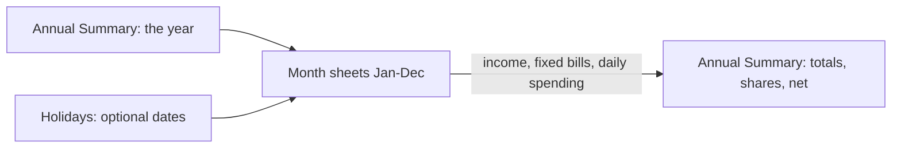

# Family Book Template Guide

An Excel workbook for tracking a family's income and spending, month by month, with an automatic yearly summary.
The template is [`template/family-book-template.xlsx`](../template/family-book-template.xlsx). It is completely empty: all labels and formulas are in place, and no year or dates show until the year is set.

If you use Family Book with Grok Bot, the bot creates each year's book for you with the year, currency, and public holidays already filled in, and logs your receipts. You can skip straight to [Workbook layout](#workbook-layout) to see where things go. If you use the template by hand, follow [Getting started](#getting-started).

Adapted from a Microsoft Template Center template (original author: Antony Liaw). Currency in the template is CAD. With Grok Bot, your currency is applied at setup; by hand, change the number format if you use another currency.

## How it works



Entries go into the **month sheets**; the year is set once per book (by the bot, or by you if you use the template by hand). Everything on the **Annual Summary** is calculated.

## Workbook layout

| Sheet | Purpose | You type here? |
|---|---|---|
| Annual Summary | Year, monthly balance, expenses by category, share of expenses, net | Only the year (`F5`), and only by hand; the bot fills it in |
| Jan ... Dec | One sheet per month: income, fixed expenses, daily spending | Yes |
| Holidays | Optional public holidays, company holidays and anniversaries, shown on the matching day in each month | Optional |
| Log (hidden) | Shared dedupe list used by Family Book bots, so the same purchase is not entered twice | No |
| Cards | One row per card: issuer, product, last 4, holder, statement day, due day, last amount due, paid status | The bot writes it. You can mark a bill paid |
| Merchant Map (hidden) | Learned merchant → category pairs | The bot writes it |
| Statements (hidden) | One row per imported statement | The bot writes it |
| Transactions (bottom of each month) | One row per statement line, below the totals | The bot writes it. You can read it |
| Receipts (below Transactions) | One row per receipt | The bot writes it. You can read it |

The note at the top of Annual Summary shows the template version (v2.0) and the credit "Family Book v2.0 by SkybatanX" with "Follow @SkyXFunNext on X for more templates and fun!". Cell `B46` is the label `Book version` and cell `C46` is `v2.0`. Bots read `C46` to see whether an older book still needs the one-time update described in [migration-v2.0.md](migration-v2.0.md). Leave both cells alone.

### Log sheet

The Log sheet is hidden. It is the dedupe list for the whole year, including when several people's bots share one book. The receipt list at the bottom of each month shows the same purchases. If you unhide the Log, leave the rows alone.

Row 1 is the header. Data starts on row 2. `H1` is a note for people. On a row that is waiting for a yes or no, column H lists the dates in that question. Bots do not write amounts there.

| Column | Header | What a bot writes |
|---|---|---|
| A | Source | Entries joined with `, `. A photo is `photo`. An email is `email gmail/<addr> <msgid>`. A second photo is `photo, photo`. A question is `open question: candidates <dates>; <source>` |
| B | Date | Purchase date, as `YYYY-MM-DD` |
| C | Merchant | Merchant name, with no person's name |
| D | Total | Receipt total |
| E | Where written | The amount cell, recorded before the amount is written, such as `Oct!K6`. If a retry finds this blank, it records a cell whose text contains the short store name and that already has this amount, including a split's item cells and Fixed Expenses or Income rows, and writes nothing. Only if none is found does it use the first empty cell |
| F | Saved file | Every file, including a single one: `1 photo: <url>`, or `1 photo: <url> \| 2 email: <url>`. Filled in once the file is in `receipts` |
| G | Logged by | Who logged it, such as `Mom` |
| H | Notes | Dates in an open question, such as `2026-10-10; candidates 2026-10-11, 2026-10-03`. `H1` stays the book note |
| I | Receipt/order # | The receipt or order number. A fuel AUTH code is not one |
| J | Date & time | Date and time, when the receipt shows a time. The date printed on the receipt wins |
| K | Items | Line items, as `product: price; product: price` |
| L | Payment | Card last 4 digits, when the receipt shows them |
| M | Month list row | The matching row on the month sheet, such as `Oct!B49` |
| N | Status | `pending` while a write is in progress, `question` while a yes/no is open and the grid is untouched, then `awaiting statement`, `cash`, `no receipt`, `matched`, or `done` when the row is finished, or `superseded` when a duplicate was confirmed. A superseded row stays. Do not delete rows |
| O | Content hash | SHA-256 of each saved file. This is the check that recognizes the same file again, including after a rename |
| P | Txn key | `last4\|post date\|amount\|normalized description\|occurrence`. Statements have no transaction id, so this key is the id |
| Q–V | Card, Post date, FX note, Linked to, Statement file, Section row | The statement side of the same purchase |

The Log row is written before the amount, with the amount cell already named in column E, so a retry cannot add the purchase on the next empty row. A photo or email receipt is not marked `done` until its file is saved in that year's `receipts` folder. If you use the template by hand and ignore the bots, you can ignore this sheet. Do not delete Log rows.

### Transactions this month, then Receipts this month

Each month sheet keeps the number grid on top. Rows 1 to 44 are the income, bills, daily record, and totals. Rows 45 and 46 are blank on purpose. Nothing below row 44 is included in a total.

| Row | What |
|---|---|
| 47 | The heading `Transactions this month`, merged from column B through column I only. Columns A:I are frozen, so the heading does not merge into column J |
| 48 | Transaction headers |
| 49 to 148 | One row per statement line |
| 150 | The heading `Receipts this month`, also merged B through I only |
| 151 | Receipt headers |
| 152 onward | One row per receipt |

Transactions columns: B Card (`CIBC Visa-1001`), C Trans date, D Post date, F Description, G Amount, I Category (`(split)` when a receipt splits it), J Receipt #. Columns E and H stay empty. They are the narrow spacers (Excel width 1.63; a connector sets them to 20 px). Helper columns start at CA, past day 31: txn key, statement file, FX note, status, where written, issuer category, linked key.

Receipts columns: B Receipt #, C Store, D Date & time, F Total, G Card/pay (last 4, or `cash`), then up to six Item / Price / Category groups starting at column I, and File in column AA. The same helper columns hold the receipt key, the file list, a note, the status, where written, the return-window days, and the linked statement key.

The title row is 40 pt in Excel and 53 px on the Sheets connector. The header row is 32 pt in Excel and 43 px on the connector. Amounts use two decimals. The connector cannot read a cell's format and cannot hide a tab.

A transaction with a receipt fills the grid from the receipt's items. A transaction with no receipt uses its category for the whole amount. A cash receipt fills the grid by itself. A receipt that arrives first is pending until the statement line links to it. The amount is written once.

Statement files use `Family Book - {year}/statements/{Issuer Product}-{last4}/YYYY-MM-DD statement.ext`. Receipt files stay `YYYY-MM-DD HHMM - Store - TOTAL.ext`. `Costco.ca` is `Costco`.

Education & Enrichment on the month sheet totals row 28 only. Fuel is row 29 and is not part of that total. Fuel still counts in the month's living expenses, so the balance includes it.

### Cards

One row per card, from row 3. Issuer, product, last 4, holder, statement day, due day, last amount due, and paid status (`unpaid` or `paid`). The bot learns a card from the first statement when you do not name it. A payment on the statement being imported paid the previous bill. The new amount due stays unpaid until you say it is paid, or a bank payment names that last 4.

Bank accounts are optional. With no bank file the book tracks expenses only. With bank data, a recurring debit goes to Fixed Expenses, a deposit goes to Income after you confirm it, and a transfer or a card payment is skipped.


## Getting started

**With Grok Bot:** nothing to do here. The bot copies the template into a `Family Book` folder in your storage, with one folder per year inside it, sets the year in `F5`, applies your currency, and fills in your public holidays. See the [setup guide](setup-guide.md).

**By hand:**

1. Copy the template and rename it (for example `Family Book 2026.xlsx`).
2. On **Annual Summary**, enter the year in `F5` (it starts empty). Every month sheet takes its dates from this cell, so the day headers stay blank until the year is set.
3. Fill in each month sheet as described below.
4. Read the totals on **Annual Summary**.

Light grey cells are formulas; do not overwrite them. Use the "Back to Annual Summary" link at the top of a sheet to navigate, and the month names on Annual Summary to jump to a month.

## Filling in a month sheet

### 1. Income This Month (left, top)

Enter each income source in a row: **Item**, **Amount**, **Date Received** (up to 4 rows). *Total Income* is calculated.

### 2. Fixed Expenses This Month (left, bottom)

Recurring bills. Enter the **Amount** and **Date Paid** next to the pre-set item:

| Item | Notes |
|---|---|
| Income offset | Row 18. Enter as a **negative** number (for example rental income). It is an offset, not salary. Salary goes in Income This Month. The offset is excluded from *Total Expenses* on Annual Summary |
| GAS, Electricity & Water, RESP, Mobile Phone, Daycare | |
| Rent / Mortgage, Internet, Car Insurance, Property Tax | |
| Fuel / Maintenance, Home Insurance, Car Loan Payment | |
| Housing Management Fee, Term Deposit, Pocket Money, Savings | Counted in the monthly balance, but **not** in the Annual Summary category table |

Rename or reuse items to suit your family; keep each amount in the same row so the Annual Summary links stay correct.

### 3. Daily Record (right)

Each day has two columns: **Item** (what/where) and **Amount**. Day 1 is J and K. Each following day is the next pair: day 29 is BN and BO, day 30 is BP and BQ, and day 31 is BR and BS. Daily totals run through column BS. Put each purchase in the row of its category. Weekends are highlighted, and holidays/anniversaries from the Holidays sheet appear at the top of the day.

### 4. Results (middle)

*Living Expenses This Month*, *Balance This Month* and *Cumulative Balance* are calculated:

```text
Balance This Month = Total Income - Total Fixed Expenses - Total Living Expenses + Temporary Income
Cumulative Balance = this month's balance + previous month's cumulative balance
```

*Temporary Income* (row 43) is one-off money received on a given day (a refund, cash back, a sold item). *Notes This Month* is free text.

## How expenses are categorised

Place each daily purchase in the row for its category. These rows feed the Annual Summary.

| Category (daily rows) | Rows | Annual Summary line |
|---|---|---|
| Meals (staple foods and side dishes for home cooking) | 6-16 | Food (Meals) |
| Dining Out (restaurants, takeout) | 20 | Food (Meals) |
| Snacks & Groceries (snacks and general grocery-store trips) | 17-19 | Snacks & Groceries |
| Household Goods | 22-27 | Household Goods |
| Education & Enrichment (lessons, classes, books) | 28 | Education & Enrichment |
| Fuel | 29 | Fuel |
| Clothing | 30-31 | Clothing |
| Medical | 32 | Medical |
| Hair & Cosmetics | 33 | Hair & Cosmetics |
| Transportation (transit, parking, tolls) | 34 | Transportation |
| Entertainment (subscriptions, movies, outings) | 35 | Entertainment |
| Gifts & Social | 36 | Gifts & Social |
| Other | 37-40 | Other |

Rules of thumb:

- **Pick one category per purchase.** Do not enter the same amount twice. If a receipt spans categories (for example one store trip with food and household items), split it into separate entries, one per category.
- **Row 41 is not part of the Annual Summary categories.** Use rows 37-40 for "Other".
- A row can hold several entries on the same day by typing a sum in the Amount cell, for example `=12.50+8.20`.
- A refund can be entered as a negative amount in the same category.
- Row 21 (*Total Food*), row 42 (*Daily Expenses Total*) and row 44 (*Balance*) are calculated; do not type there.

Fixed expenses (rent, insurance, loan, utilities) are entered once per month in the left-hand list, not in the daily record.

## Reading the Annual Summary

- **Monthly Totals / Monthly Balance:** each month's remaining balance, and the year total.
- **Expenses by Category:** every category by month, with the **Annual Total** and **Share of Expenses** (each category's share of all expenses).
- **Total Expenses** = all category lines except the *Income* line. **Net** = Total Expenses + Income (income entered as negative lowers spending).

## Tips

- Enter spending daily or weekly; keep a consistent naming style for items (for example `Costco`, not `COSTCO` and `costco`) so you can scan the record later. When several people log receipts, a short name in parentheses shows who entered the line, for example `Costco (Mom)`.
- Leave days that do not exist in a month (such as the 31st of a 30-day month) blank; they stay empty automatically.
- **Holidays sheet:** the year in each date must match the year, otherwise it will not show. Leave unused cells empty.
- **Google Sheets:** the file can be imported (Drive > open with Google Sheets). Formulas work, but click-test the navigation links, and set the sheet locale so weekday names display correctly.
- Make a fresh copy of the template each year rather than overwriting an old year (Grok Bot does this for you each December).
